# Jurix

Advogados autônomos costumam controlar clientes, processos, honorários e prazos em planilhas e cadernos separados. Assim, ninguém responde rápido a perguntas como "quem está me devendo?", "quanto entra nos próximos 3 meses?" ou "que prazo vence esta semana?".
O Jurix é um app de desktop que junta tudo isso num lugar só e calcula sozinho a situação financeira de cada cliente, a inadimplência e a projeção de caixa.

**Em uso real:** uma advogada autônoma usa o Jurix no dia a dia e estima que ele economiza **cerca de 2 horas por dia** de controle manual.

**Feito do zero em 5 dias** (15 a 19 de maio de 2026) com o Claude Code, num fluxo guiado por especificações. Mais detalhes em [Como foi construído com IA](#como-foi-construído-com-ia).

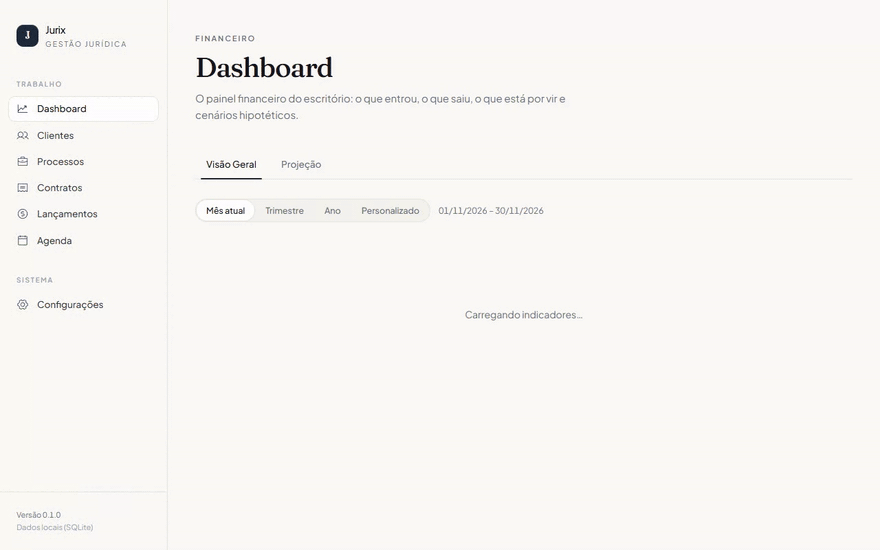

- **Demo no navegador:** https://victorpili.github.io/portfolio/jurix/ (dados fictícios; nada sai do seu navegador)
- **Instalador para Windows:** [Jurix 0.1.0 na página de Releases](https://github.com/victorpili/portfolio/releases/tag/jurix-v0.1.0)

## O que ele faz

| Módulo | O que resolve |
|---|---|
| **Clientes** | Cadastro de pessoa física e jurídica, com contatos da empresa, inscrições estaduais e matriz/filial. A situação financeira (adimplente, inadimplente, sem movimentação) é calculada a partir dos lançamentos. |
| **Processos** | Processos judiciais com número CNJ formatado e processos administrativos. Fase, parte adversa, valor da causa e chance de êxito. |
| **Contratos** | Código automático (`CTR-2026-0001`), área do direito, tipo de honorário e um resumo do que foi faturado, recebido e está em aberto. |
| **Lançamentos** | Entradas e saídas, à vista ou parceladas. As parcelas são geradas automaticamente e cada uma tem o próprio status. Uma parcela vencida vira inadimplência sem ninguém precisar marcar. |
| **Agenda** | Audiências, prazos e reuniões ligados a clientes e processos, com uma janela de alerta configurável e as visões de calendário, semana e próximos dias. |
| **Dashboard** | Entradas, saídas, ticket médio e inadimplência por período. Mostra cenários (pior, garantido e melhor), receita por área, o alerta de concentração ("um cliente faz 45% do faturamento"), a projeção de 3, 6 e 12 meses ponderada pela chance de êxito dos processos e um simulador de cenários (novo contrato, nova despesa, perda de cliente). |
| **Configurações** | Listas auxiliares editáveis: áreas do direito, tipos de contrato, centros de custo, origens e tipos de evento. |

Os dados ficam num banco SQLite no próprio computador. Não há servidor, mensalidade nem dado de cliente na nuvem, o que pesa para quem lida com sigilo profissional.

## Como foi construído com IA

O código foi escrito pelo Claude Code. O meu trabalho foi decidir o que construir, escrever o que cada módulo precisava fazer, conferir o resultado no uso real e corrigir o rumo.

**1. Especificação antes do código.** Cada módulo começou como uma proposta no [OpenSpec](openspec/changes/), com quatro arquivos:
- `proposal.md`: o porquê;
- `design.md`: as decisões;
- `spec.md`: os requisitos, cada um com cenários de aceite no formato *WHEN / THEN*;
- `tasks.md`: as tarefas.

O Claude implementava tarefa por tarefa, e a spec só fechava validada (`openspec validate`). No total, foram 7 especificações e 141 tarefas.

**2. Memória entre sessões.** Duas peças guardam o contexto do projeto:
- [`CLAUDE.md`](CLAUDE.md) guarda as decisões que não podem se perder (dinheiro em centavos, documentos só com dígitos, a linguagem visual);
- [`HANDOFF.md`](HANDOFF.md) registra a arquitetura, o estado de cada módulo e os problemas já resolvidos.

Com isso, cada nova sessão começava sabendo o que a anterior tinha decidido.

**3. Validação com quem usa.** Cada módulo passou por um teste manual no app, e o que não servia no dia a dia voltava como requisito. Dois exemplos:
- *Todo menu de seleção precisa ter busca por digitação.* Com centenas de clientes, um `<select>` comum fica inutilizável. Isso virou o componente [`Combobox`](src/components/ui/Combobox.tsx), que ignora acentos e funciona pelo teclado.
- *Matriz e filial só existem para pessoa jurídica.* O pedido inicial falava em pessoa física. A dúvida foi levantada, confirmada com quem usa e entrou na spec.

**4. Erros reais, corrigidos e documentados.** Alguns exemplos da [lista completa](HANDOFF.md#5-problemas-encontrados-e-soluções):

| Problema | Causa | Correção |
|---|---|---|
| `database is locked` | `BEGIN`/`COMMIT` manuais em chamadas que o plugin roda em conexões diferentes do pool | Transações manuais proibidas: exclusões em cascata (`ON DELETE CASCADE`) ou em ordem segura |
| O cursor pulava no campo de valor | O campo reformatava o valor a cada tecla | Reescrito para acumular dígitos pela direita, com o cursor fixo no fim |
| Erro ao excluir cliente com processos | Chave estrangeira sem regra de exclusão | Bloqueia a exclusão se houver contrato ativo ou processo em andamento; senão, exclui em ordem segura |

**Em números:** 7 módulos, 12 migrações de banco, 141 tarefas de especificação e cerca de 14 mil linhas de TypeScript, entregues como instalador de Windows em 5 dias.

## Telas

| | |
|---|---|
| 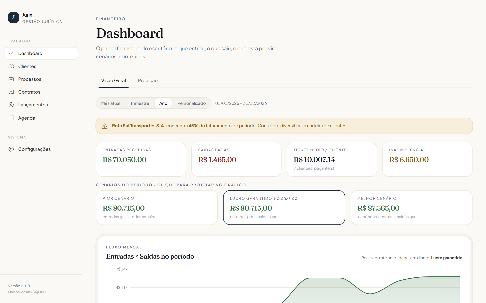 | 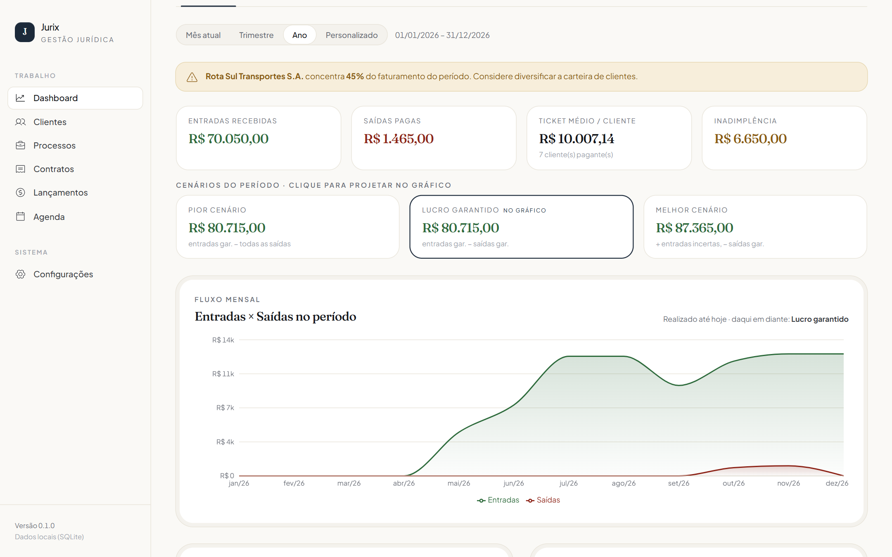 |
| **Dashboard:** KPIs do período, cenários e alerta de concentração | **Fluxo mensal:** realizado até hoje, projetado daqui em diante |
| 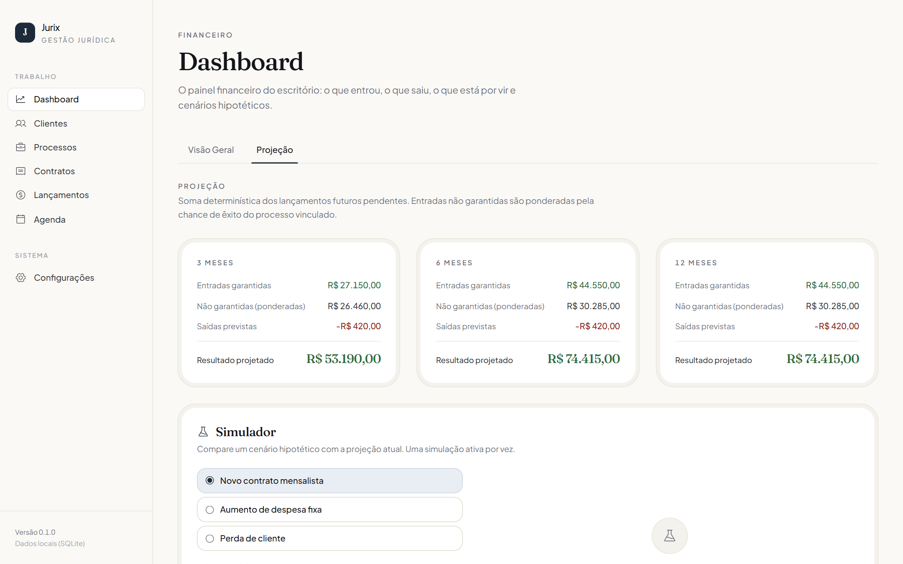 | 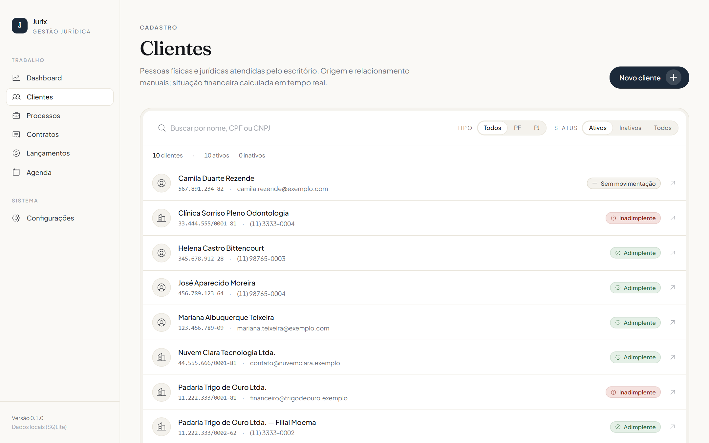 |
| **Projeção:** entradas incertas ponderadas pela chance de êxito | **Clientes:** situação financeira calculada em tempo real |
| 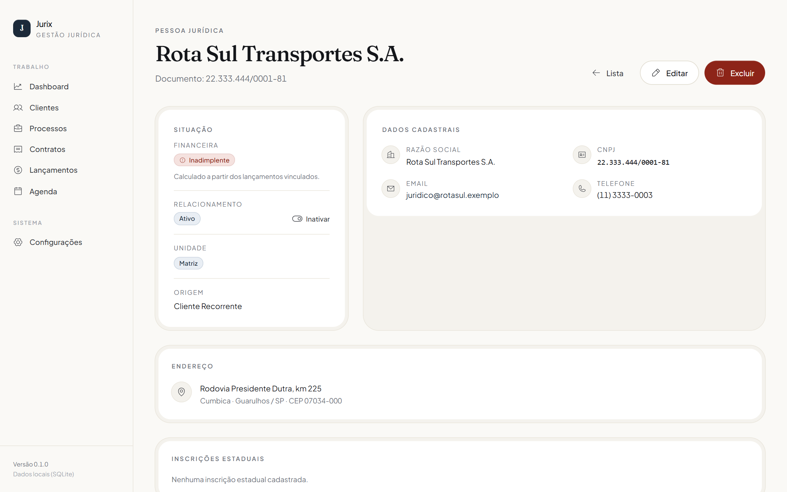 | 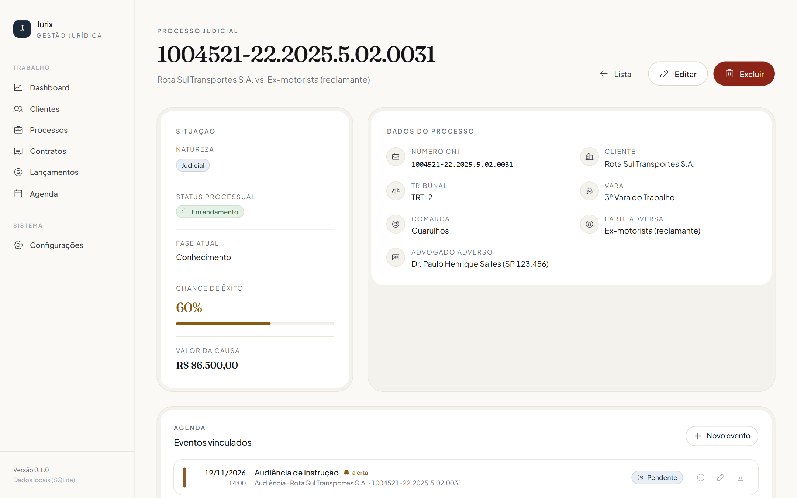 |
| **Cliente PJ:** unidade, origem, contatos e vínculos | **Processo:** número CNJ, fase, parte adversa e chance de êxito |
| 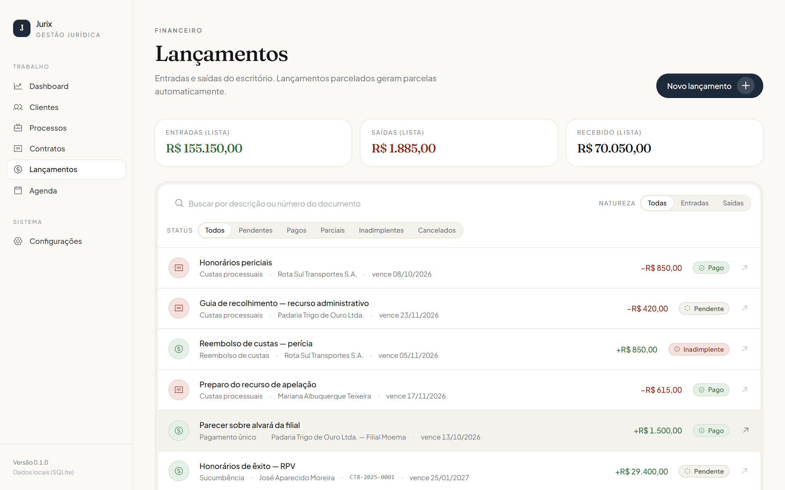 | 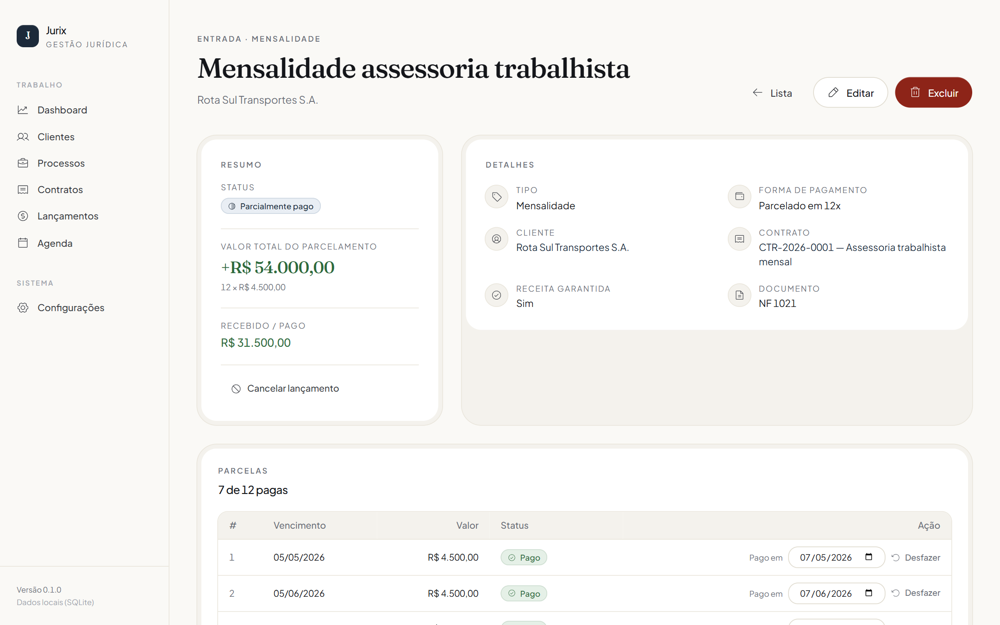 |
| **Lançamentos:** entradas, saídas e status efetivo | **Parcelado:** parcelas geradas sozinhas, pagamento por parcela |
| 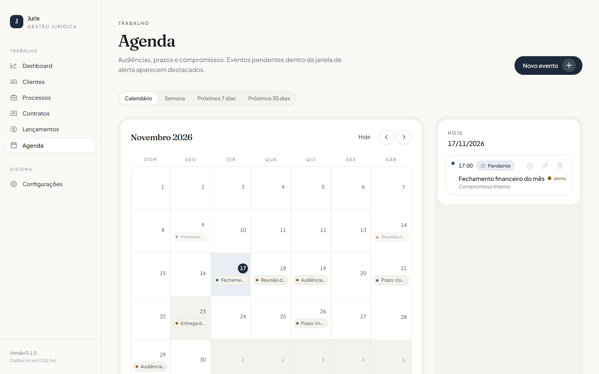 | 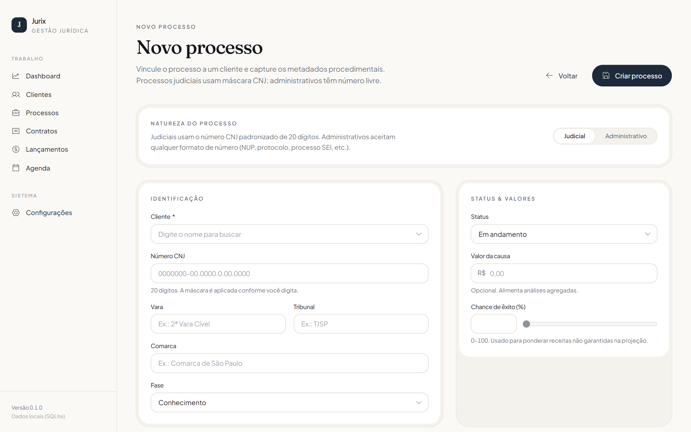 |
| **Agenda:** prazos e audiências com alerta antecipado | **Formulários:** máscaras e busca por digitação em todos os campos de seleção |

Todos os nomes, documentos e valores das imagens são fictícios.

## A demo no navegador

O Jurix é um app de desktop: as telas, em React, falam com o SQLite através de um plugin do Tauri. Para que ele possa ser aberto por um link, a demo web troca **só esse plugin** por um substituto que roda o SQLite dentro do navegador ([sql.js](https://sql.js.org), o SQLite compilado para WebAssembly).

- As migrações são os mesmos arquivos de [`src-tauri/migrations/`](src-tauri/migrations/) que o app desktop aplica.
- A troca é feita por um alias do Vite no modo `demo` ([`vite.config.ts`](vite.config.ts)). Nenhuma tela e nenhuma regra de negócio muda.
- Os dados fictícios ([`src/demo/seed.ts`](src/demo/seed.ts)) são criados pelas mesmas funções que as telas usam, então validações, parcelas e inadimplência se comportam como no app de verdade.
- O banco vive na memória da aba: dá para criar, editar e excluir, e recarregar a página restaura o estado inicial.

## Como rodar

```bash
npm install

npm run dev:demo        # demo web em http://localhost:1420 (não precisa de Rust)
npm run build:demo      # gera a demo estática em dist-demo/

npm run tauri dev       # app desktop (precisa do Rust: https://rustup.rs)
npm run tauri build     # instalador .exe/.msi em src-tauri/target/release/bundle/

npx tsc --noEmit        # checagem de tipos
npx openspec list       # andamento das especificações
```

## Stack

Tauri 2 (Rust) · React 19 · TypeScript 5.8 · Vite 7 · Tailwind CSS 4 · SQLite (`@tauri-apps/plugin-sql`) · React Router 7 · Recharts 3 · OpenSpec · Claude Code

## Onde está cada coisa

- [`src/features/`](src/features/): um módulo por pasta (`api.ts` com as regras e o SQL, `types.ts`, `pages/`, `components/`)
- [`src/components/ui/`](src/components/ui/): componentes compartilhados (`Combobox`, `CurrencyInput`, `Card`…)
- [`src-tauri/migrations/`](src-tauri/migrations/): o esquema do banco, migração por migração
- [`openspec/changes/`](openspec/changes/): a especificação de cada módulo
- [`src/demo/`](src/demo/): o que só existe na demo web (o substituto do SQLite, os dados fictícios e o aviso)
- [`HANDOFF.md`](HANDOFF.md) e [`CLAUDE.md`](CLAUDE.md): o contexto do projeto para pessoas e para o Claude
