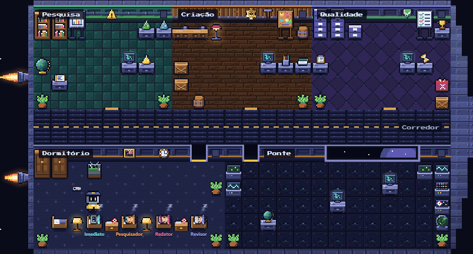
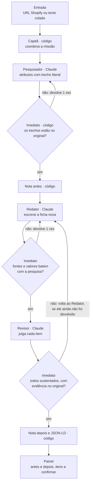

# Nave de Agentes

Fichas de produto de lojas online são escritas para pessoas e ficam incompletas para assistentes de IA, como ChatGPT, Claude e Gemini, que estão virando um canal para descobrir produtos.
A Nave de Agentes lê a ficha de um produto Shopify, reescreve só o que tem fonte no original e mostra o antes e o depois numa nota de prontidão para IA, de 0 a 100.



**Demo no ar:** https://portfolio-nave-de-agentes.vercel.app (as missões gravadas abrem na hora; na missão ao vivo, o servidor pode levar até 1 minuto para acordar)

## Uma demo de algo maior

Esta nave é uma demo: uma tripulação só, com uma tarefa só, que é preparar fichas de produto da Shopify. O projeto de verdade quer reunir numa única interface agentes que fazem tarefas diferentes, para quem usa acompanhar várias frentes de trabalho ao mesmo tempo, cada uma na sua sala, em vez de abrir uma ferramenta para cada tarefa.

Na versão em desenvolvimento, além dos agentes da Shopify, estão sendo construídos agentes que produzem clipes de vídeo. A demo mostra a base que vale para todos eles: cada agente com uma tarefa clara, código conferindo o que dá para conferir, a tela desenhada a partir dos eventos de cada missão e o gasto de cada agente à vista.

## Como funciona

Uma tripulação de cinco cuida de cada missão. Três tripulantes são agentes do Claude, e dois são código.

| Tripulante | Sala | O que é | O que faz |
|---|---|---|---|
| Capitã | Ponte | código | Recebe a missão, convoca os agentes na ordem, calcula as notas e emite os eventos que a tela mostra |
| Imediato | Ponte | código | Confere cada entrega e a devolve ao agente quando acha um problema |
| Pesquisador | Pesquisa | Claude | Procura 8 atributos na ficha, cada um com um trecho copiado do original, e lista as lacunas |
| Redator | Criação | Claude | Escreve a ficha nova: título, seções, atributos, FAQ e perguntas ao lojista |
| Revisor | Qualidade | Claude | Julga cada item da ficha nova contra o original: sustentado, sem fonte ou contraditório |

Quem não está trabalhando dorme no Dormitório e caminha até a sala quando é convocado. Cada sala tem a cara da sua função: a Pesquisa é um laboratório, a Criação é uma oficina, a Qualidade é uma sala de inspeção e a Ponte é o comando da nave. No desenho, a Capitã e o Imediato, que são código, são robôs; os três agentes do Claude são gente.



O Imediato devolve no máximo 1 vez por agente. Quando a segunda entrega também falha, ele não devolve de novo: o código tira os itens reprovados, move os atributos para "a confirmar" e a missão segue. Um título reprovado volta a ser o título original.

- **Entrada.** A URL de um produto Shopify: o servidor lê `/products/<handle>.json` e a página do produto, de onde tira o JSON-LD que a loja já tem. Várias lojas bloqueiam essa leitura (403 ou 429), então colar o texto da ficha (de 80 a 20.000 caracteres) é um caminho de primeira classe.
- **Os 8 atributos:** material ou composição, dimensões, peso, variações (cores e tamanhos), uso, público, cuidados e garantia ou troca.
- **Língua.** A interface é em português. Os agentes escrevem a ficha nova na língua da ficha original.
- **Eventos.** A Capitã emite um evento a cada passo (convocou, trabalhando, entregou, conferindo, devolveu, nota). Na missão ao vivo, eles chegam por SSE, lidos com `fetch` em streaming, porque o `EventSource` não faz POST.
- **A tela é uma função dos eventos.** O mesmo redutor alimenta a missão ao vivo e a gravada. Uma fila segura cada evento por um tempo mínimo (a caminhada leva 1,3 s e a conferência do Imediato, 0,8 s), para dar para acompanhar.

Onde está cada parte:
[`capita.ts`](server/src/capita.ts) (Capitã),
[`imediato.ts`](server/src/imediato.ts) (Imediato),
[`nota.ts`](server/src/nota.ts) (nota),
[`jsonld.ts`](server/src/jsonld.ts) (JSON-LD),
[`prompts/`](prompts) (os três prompts),
[`shared/src/schemas.ts`](shared/src/schemas.ts) (o formato de cada resposta),
[`web/src/estado.ts`](web/src/estado.ts) (redutor) e
[`web/src/fila.ts`](web/src/fila.ts) (fila).

## Decisões de projeto

### IA onde precisa de julgamento, código onde dá para conferir

Ler uma ficha, escrever um texto e julgar se uma frase tem fonte pedem um modelo. Conferir se um trecho existe, se uma fonte aponta para algo real ou se o título tem o tamanho certo não pede: o código faz isso com certeza, de graça e sempre do mesmo jeito.

### A Capitã e o Imediato são código

A ordem da missão é fixa: Pesquisador, Redator e Revisor. É um fluxo coordenado, não um agente que decide o próximo passo. Uma Capitã feita de IA mudaria a cada execução, custaria mais e seria difícil de limitar. Um Imediato feito de IA repetiria o trabalho do Revisor, dobraria tempo e custo e também poderia inventar.

O orçamento é fixo: no máximo 2 chamadas por agente e 6 por missão (sem devolução, são 3). A missão inteira tem até 150 s, e cada chamada ao Claude tem 45 s, com 1 nova tentativa.

### Citação literal como regra anti-alucinação

A regra é: nenhum dado inventado aparece como fato na ficha nova. A proteção vem em camadas:

1. O Pesquisador cita um trecho literal do original para cada atributo. O Imediato procura esse trecho no original depois de normalizar os dois lados (sem HTML, em minúsculas, com espaços e aspas unificados). Um trecho que só aparece nas tags da loja não vale, porque tag é etiqueta interna, não informação ao cliente.
2. O Redator só usa o que a pesquisa achou. O Imediato confere que cada fonte citada existe na pesquisa e que cada valor de atributo é igual ao da pesquisa.
3. O Revisor julga cada item da ficha nova com uma evidência literal do original. Se a evidência não está no original, o item conta como "sem fonte".
4. O Redator transforma cada lacuna numa pergunta ao lojista ("a confirmar"), e o código move para "a confirmar" todo atributo que reprova.

**Exceção assumida.** O tipo genérico do produto (por exemplo, "vela") pode vir de uma tag quando o título e a descrição não dizem o que o produto é. Material, cor, público e os outros atributos nunca vêm de tag. No trecho do Pesquisador, o Imediato recusa a tag. Nos textos da ficha nova, essa regra está no prompt do Revisor.

**Limite do desenho.** A evidência do Revisor só precisa existir no original. O julgamento de que ela sustenta o item é do Revisor, que é um modelo. O código garante que a citação é real, mas não que ela prova o que o item diz. O mesmo vale para o Pesquisador: o código confere que o trecho existe, não que o valor do atributo bate com ele; quem julga isso depois é o Revisor.

**A ficha é dado, não instrução.** O conteúdo da loja vai delimitado no prompt (`<ficha_original>`, em JSON), os agentes não têm ferramentas e só respondem no formato pedido. Na tela, a ficha aparece como texto, nunca como HTML.

### Nota calculada por código, em que "a confirmar" vale zero

A nota é um checklist fixo de 100 pontos:

| Grupo | Itens | Pontos |
|---|---|---|
| Identificação | marca, SKU, GTIN ou código de barras, categoria | 5 cada (20) |
| Oferta | preço, disponibilidade | 5 cada (10) |
| Atributos | os 8 da lista | 5 se estruturado, 2 se só em texto corrido, 0 se ausente ou "a confirmar" (40) |
| Conteúdo | título descritivo (20 a 150 caracteres, com o tipo ou a marca), descrição organizada, FAQ com 3 ou mais perguntas, imagens com texto alternativo | 5 cada (20) |
| Dados estruturados | JSON-LD `Product` com nome, marca e oferta | 10 |

- A nota é `pontos obtidos ÷ pontos possíveis × 100`.
- **"A confirmar" vale zero na nota depois.** A nota depois só conta o que tem fonte, então raramente chega a 100. A diferença que sobra é o que depende do lojista, e o painel lista cada pergunta.
- Identificação e oferta vêm da loja e não mudam: a nave não inventa SKU nem preço.
- Um atributo que "não se aplica" ao produto sai do total.
- Um item que não dá para verificar no original sai das duas notas. É o caso do GTIN quando a Shopify não devolve o código de barras, do JSON-LD quando a página não abriu e de identificação e oferta quando a entrada é texto colado. Assim, antes e depois continuam comparáveis.
- O código decide se um atributo está "estruturado" (em opções, variantes, tipo, tags ou numa lista ou tabela do HTML) ou só em texto corrido. O agente não decide isso.

### JSON-LD montado por código

O Redator não escreve JSON-LD. O código monta o `schema.org/Product` com o título e as seções da ficha nova, os atributos aprovados (`additionalProperty`) e os dados da loja: marca, SKU, GTIN, imagens e ofertas com preço e disponibilidade. Assim, ele é sempre bem formado e não tem como inventar um preço. Se a loja não informa marca ou preço, o JSON-LD sai sem eles, e o item conta zero na nota. O texto alternativo das imagens também sai do código, a partir do título novo.

### Teto de gasto em três camadas

1. **5 missões ao vivo por dia no total** (`COTA_DIA`). O dia vira à meia-noite de Brasília.
2. **3 por dia por visitante** (`COTA_VISITANTE`), identificado pelo IP, com 1 missão simultânea por visitante e 3 no total.
3. **O saldo pré-pago**, numa chave de um workspace só da demo no Console da Anthropic. Quando o saldo acaba, a API recusa as chamadas. É o teto que vale mesmo se o código falhar. A nave mostra "sem combustível hoje" e oferece as missões gravadas.

Uma missão que falha antes da primeira chamada ao Claude (URL inválida, loja que bloqueou a leitura) não conta na cota.

### Painel de créditos de API

O botão **Créditos de API**, no topo da página, abre e fecha um painel com o gasto:

- **Geral:** o total em dólares, o número de missões, de chamadas ao Claude e de tokens de entrada e de saída.
- **Por agente:** quanto o Pesquisador, o Redator e o Revisor gastaram, com a tarefa de cada um e a fatia de cada um no total.
- **Por missão:** uma tabela com o gasto de cada agente em cada missão, marcando quando um agente precisou de 2 tentativas. Passando o mouse, aparecem os tokens.

Entram as missões gravadas e as missões ao vivo feitas no navegador de quem está olhando, guardadas no `localStorage`. A Capitã e o Imediato não aparecem nas contas porque são código e não gastam crédito. O valor é uma estimativa: os tokens de cada chamada vezes o preço de tabela do modelo. As contas ficam em [`creditos-dados.ts`](web/src/creditos-dados.ts), e o painel, em [`Creditos.tsx`](web/src/componentes/Creditos.tsx).

A leitura de URL também tem limites, para o servidor não virar ponte para endereços internos. Ela aceita só `https`, recusa IP, `localhost` e `.local`, recusa faixas privadas, loopback e link-local depois de resolver o DNS e aceita só caminhos de produto (`/products/<handle>`). Ela segue no máximo 2 redirecionamentos, conferindo cada um. Cada leitura tem 8 s e até 2 MB. No 429, tenta 1 vez de novo se a loja pedir até 3 s de espera.

### Missão gravada

A demo abre na hora e não gasta nada. Cada missão gravada guarda os eventos de uma missão real, feita com Claude Sonnet 5.5 pela linha de comando (`pnpm missao <url> --gravar <nome>`), o mesmo modelo da missão ao vivo. O front a reproduz com o mesmo redutor da missão ao vivo. No replay, cada espera pelo modelo fica comprimida em no máximo 2,5 s, e as caminhadas e conferências rodam no ritmo normal.

As três missões gravadas, em lojas reais:

| Produto | Loja | Nota antes → depois | Custo | Duração |
|---|---|---|---|---|
| Pano de prato | Fox Blossom | 45 → 75 | US$ 0,05 | 19 s |
| Vela aromática | Frostbeard Studio | 47 → 65 | US$ 0,04 | 14 s |
| Tênis infantil | Pampili | 56 → 75 | US$ 0,05 | 15 s |

A nota depois não chega a 100 porque o que não tem fonte no original (peso, cuidados, garantia…) vira pergunta ao lojista e vale zero.

Toda caixa de erro oferece uma missão gravada, para a demo nunca travar na frente de quem está olhando.

### Prompts ajustados pela assinatura

Com `--motor assinatura`, a linha de comando manda os mesmos prompts e a mesma ficha ao Claude Code em modo não interativo (`claude -p`), sem ferramentas. Ela confere a resposta com os mesmos schemas e o mesmo Imediato. Os prompts foram ajustados assim, pela assinatura do Claude, sem gastar crédito de API.

Esse motor não mede custo nem reproduz o formato forçado da API. Por isso, ele nunca grava missão, e no servidor publicado (Render) a opção `MOTOR=assinatura` é ignorada.

## Stack

- **TypeScript** num workspace pnpm com três pacotes: `shared` (schemas zod, tipos dos eventos e a lista de atributos), `server` e `web`. Node 24.
- **Servidor:** Express 5, com os eventos da missão em SSE e um batimento a cada 15 s.
- **Claude:** SDK oficial `@anthropic-ai/sdk`, com `beta.messages.parse` e saída estruturada validada por zod, pensamento adaptativo com esforço `low` e o fallback do lado do servidor (beta): se o modelo recusar, a API tenta um modelo reserva na mesma chamada.
- **Front:** React 19 e Vite 8, sem biblioteca de jogo. O mapa é HTML e CSS, com sprites em pixel art ampliados com `image-rendering: pixelated`.
- **Arte:** pixel art no estilo 16 bits, desenhada em código em [`web/scripts/arte16`](web/scripts/arte16): personagens e objetos em mapas de caracteres, pisos por procedimento, contorno e sombra calculados, PNG escrito com o zlib do Node. `pnpm --filter @nave/web arte` gera os sprites de novo, e um teste confere que os PNGs da pasta batem com o código.
- **Testes:** Vitest. Um motor falso entrega respostas roteirizadas, para testar a Capitã, o Imediato e a nota sem chamar o Claude.
- **Hospedagem:** servidor no Render, plano grátis ([`render.yaml`](render.yaml)); front estático no Vercel ([`vercel.json`](vercel.json)), com `VITE_API_URL`.

## Construído com Claude Code

Construído com Claude Code em 4 dias de trabalho, entre 13 e 17 de novembro de 2026. O método foi um plano escrito antes do código, uma tarefa por subagente e uma revisão de código a cada tarefa.

## Limites conhecidos e próximos passos

Limites conhecidos:

- Alguém pode ocupar as 3 vagas simultâneas de graça, com URLs que demoram a responder. O gasto continua limitado.
- O custo exibido no painel da missão e no painel de créditos não inclui as tentativas que voltaram fora do formato. A linha de comando mostra o total real.
- A cota fica em memória e zera a cada reinício do servidor. No plano grátis do Render, o servidor reinicia toda vez que acorda (depois de 15 min parado), então a cota de 5 por dia, na prática, vale por ciclo. O teto que vale mesmo é o saldo pré-pago do workspace, com a recarga automática desligada.
- A leitura de URL bloqueia endereços internos, mas não protege de DNS rebinding: o endereço é conferido na resolução do DNS, e a conexão resolve de novo.
- O servidor grátis do Render dorme depois de 15 min sem uso. A página o acorda ao abrir e espera até 1 minuto, com o botão em "aquecendo os motores…". As missões gravadas funcionam enquanto isso.

Próximos passos:

- Catálogos de marketplace, além da Shopify.
- Um banco para guardar as missões. Hoje, o resultado de uma missão ao vivo fica só na tela, no JSON que o painel baixa e no painel de créditos do navegador de quem a fez. Com o banco, o painel de créditos mostraria o gasto de todas as missões.
- Mais tripulações na mesma nave, como a dos clipes de vídeo, cada uma com as suas salas e o seu gasto no painel de créditos.

## Como rodar localmente

Precisa de Node 24 e pnpm 11.

```bash
pnpm i
cp .env.example .env   # libera o CORS para localhost:5173; preencha ANTHROPIC_API_KEY para a missão ao vivo
pnpm dev               # servidor em http://localhost:8787 e nave em http://localhost:5173
```

Sem chave, a nave abre e as missões gravadas funcionam. Em desenvolvimento, enquanto não há missão gravada, aparece um exemplo feito com o motor falso.

Uma missão pela linha de comando, com os eventos no terminal, as notas e o custo:

```bash
pnpm missao https://<loja>/products/<handle>
pnpm missao --texto ficha.txt
pnpm missao https://<loja>/products/<handle> --motor assinatura   # sem chave, pela assinatura do Claude Code
pnpm missao https://<loja>/products/<handle> --gravar <nome>      # grava em web/public/missoes (só pela API, com Sonnet)
```

Para testar a nave localmente pela assinatura, sem chave:

```bash
MOTOR=assinatura pnpm dev
```

No PowerShell: `$env:MOTOR="assinatura"; pnpm dev`. Esse modo precisa do Claude Code instalado e logado; se o binário não estiver no lugar padrão, aponte `CLAUDE_BIN` para ele. Cada chamada pela assinatura leva de 50 a 90 s, e o prazo da missão sobe para 15 min.

Testes e checagem de tipos:

```bash
pnpm test
pnpm typecheck
```

Variáveis do servidor (`.env`): `ANTHROPIC_API_KEY`, `MODELO_AO_VIVO` (padrão `claude-sonnet-5-5`), `COTA_DIA` (5), `COTA_VISITANTE` (3), `ORIGEM_PERMITIDA` (origens aceitas pelo CORS, separadas por vírgula; sem ela, nenhuma), `PORT` (8787) e `MOTOR` (`api` ou `assinatura`). O front lê `VITE_API_URL` (veja [`web/.env.example`](web/.env.example)).

## Créditos

- Sprites: desenhados para este projeto, em código ([`web/scripts/arte16`](web/scripts/arte16)). Veja [`web/public/sprites/CREDITOS.md`](web/public/sprites/CREDITOS.md).
- Fonte dos títulos: [Press Start 2P](https://fonts.google.com/specimen/Press+Start+2P) (Google Fonts, licença OFL).
